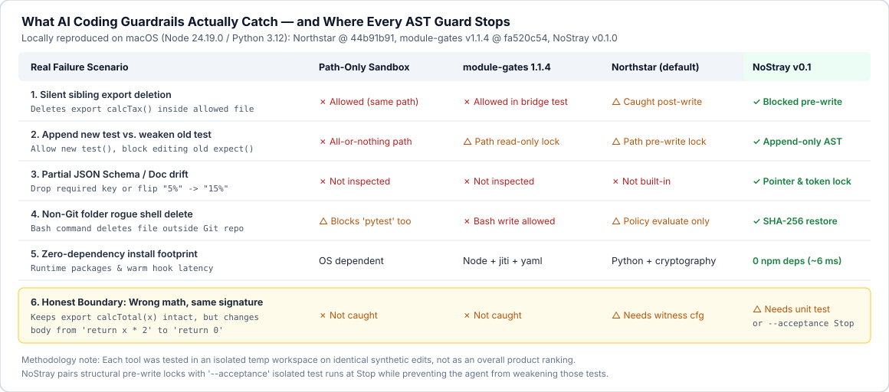
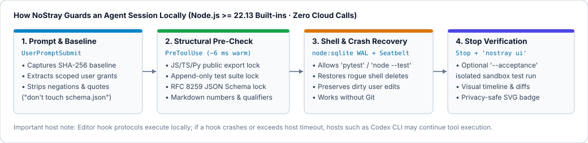

# NoStray (`nostray`)

> **Ask an AI coding agent for a 2-line bugfix. Keep the neighboring functions, tests, and schemas intact.**  
> Local structural guard & byte-exact rollback for **Claude Code**, **OpenAI Codex CLI**, **Antigravity**, **Cursor**, **Git `pre-commit`**, and **non-Git folders**. Zero npm dependencies. Zero LLM calls.

[](./LICENSE)
[](./package.json)
[](./examples/five-stray-edits)

[简体中文说明 (README.zh-CN.md)](./README.zh-CN.md) · [5 Reproducible Stray-Edit Cases (`examples/`)](./examples/five-stray-edits)



---

## The Problem: 5 Stray Edits Every AI Coding User Recognizes

Path-only sandboxes check *which folder* an agent writes to. In daily coding, most collateral damage happens **inside files the agent was allowed to touch**, or through helper scripts:

1. **Silent Sibling Export Deletion** — You ask to fix rounding in `calcTotal()`. While "cleaning up" `checkout.mjs`, the agent deletes `export function calcTax()` used by three other modules.
2. **Test Weakening** — Instead of fixing the bug, the agent edits an existing `expect(...)` assertion or `beforeEach` setup so red tests turn green.
3. **Upstream Schema Shortcut** — Rather than populating `taxCents` in a leaf handler, the agent removes `"taxCents"` from `"required"` in `order.schema.json`.
4. **Markdown Number & Qualifier Drift** — Asked to polish `# Summary`, the agent rewrites a neighboring section or turns `"5% (pending verification)"` into `"15%"`.
5. **Non-Git Rogue Shell Deletes** — In a local prototype or research folder without Git, a one-liner cleanup command wipes uncommitted files with no `git checkout` to recover them.

**NoStray** checks structural invariants locally in **~6 ms** (using Node.js `>=22.13.0` built-in `node:sqlite` WAL, SHA-256 content-addressed snapshots, stateful JS/TS/Python/JSON/CommonMark scanners, and OS sandboxing) — blocking stray edits before write when possible, and restoring unexpected shell mutations byte-for-byte.

---

## Try It Without Touching Your Project (30 Seconds)

Requires **Node.js `>= 22.13.0`** (uses built-in `node:sqlite`).

### Option A: Run from npm (once published) or a local checkout

```bash
git clone https://github.com/Dengk3Li/nostray.git
cd nostray

# 1. Run all 5 live stray-edit & rollback scenarios in a disposable /tmp sandbox
node ./bin/nostray.mjs demo

# 2. Open the local visual timeline, diff inspector & sandbox studio (127.0.0.1)
node ./bin/nostray.mjs ui
```

*(Note: `blast-guard` is preserved as a CLI alias to `nostray` for existing scripts.)*

### Option B: Inspect or Guard a Real Small/Medium Repository

```bash
NOSTRAY="$PWD/bin/nostray.mjs"
cd /path/to/your/project

# Read-only health & blast-radius check (writes zero files, redacts local paths by default)
node "$NOSTRAY" audit .

# Preview hook wiring without modifying anything
node "$NOSTRAY" init --host codex --dry-run

# Install hooks (choose: claude | codex | antigravity | cursor | git | all)
node "$NOSTRAY" init --host git
node "$NOSTRAY" init --host codex

# Verify hook installation & runtime readiness
node "$NOSTRAY" status --host codex --verify

# Cleanly uninstall anytime
node "$NOSTRAY" init --host all --uninstall
```

---

## What NoStray Catches — and Honest Boundaries



We care more about predictable behavior than marketing claims. Before enabling NoStray on critical work, know both sides:

| Capability / Scenario | How NoStray Handles It |
|---|---|
| **Deleting or changing signature of sibling JS/TS/Python exports** | **Blocked pre-write** (`PUBLIC_EXPORT_MUTATED`) on structured edits unless explicitly authorized in your prompt. |
| **Adding new tests vs. editing existing tests** | **Appending** literal-title `test(...)` / `def test_...` blocks is allowed; editing existing test bodies or `beforeEach` setup is **blocked pre-write**. |
| **JSON Schema & config contracts (`*schema*.json`, `package.json`, `.d.ts`)** | Locked by default; supports scoped RFC 6901 JSON Pointer grants when you explicitly ask to update a field. |
| **Running `node --test`, `pytest`, or build checks** | Allowed without manual DSL headers; wrapped checkpoints restore unauthorized file mutations while preserving your dirty edits. |
| **Wrong business math under an unchanged signature** *(e.g. `return x * 2` -> `return 0`)* | **Not caught by AST signature checks alone.** Pair with unit tests or `nostray session start --acceptance plan.json` so `Stop` runs isolated regression tests while NoStray prevents the agent from weakening those tests. |
| **Editor hook timeouts or crashes** | Editor hook protocols (such as [OpenAI Codex hooks](https://learn.chatgpt.com/docs/hooks)) may fail open if a hook times out or errors. Add `nostray init --host git` (`pre-commit`) as a second commit-time barrier. |
| **Workspace size limits** | Default recovery snapshot limits are **16 MiB per file** and **256 MiB total workspace**. Best suited for focused codebases rather than multi-gigabyte data monorepos. |

---

## How It Works Under the Hood



1. **Negation-Aware Prompt Grants**: Saying *"Fix `checkout.mjs`, do NOT touch `order.schema.json`"* never unlocks `order.schema.json`. Reference clauses, stack traces, and blockquotes grant zero permissions.
2. **Human-Readable Interception Cards**: When an edit is blocked, both you and the agent get a clear card showing the task, the attempted stray change, downstream caller count, and 3 concrete options (stay within scope, grant explicit one-session permission, or inspect in `nostray ui`).
3. **Crash-Safe Non-Git Recovery (`node:sqlite` WAL)**: Content-addressed SHA-256 blobs + atomic journal replay restore deleted or mutated files and executable permissions (`0755`) without wiping uncommitted user edits.
4. **Local Session Studio (`nostray ui`)**: Zero-dependency `127.0.0.1` web view to inspect blocked diffs, replay the 5 stray-edit scenarios, and export a path-redacted SVG session badge.

---

## Tested Host Matrix (`v0.1.0`)

| Host | Tested Version Range | Wired Events | Verification Level (`status --verify`) |
|---|---|---|---|
| **Git** | `2.30.0 .. 2.50.x` | `pre-commit` (chains existing user hooks; supports CJK paths & unborn `HEAD`) | Live `git commit` E2E verified |
| **OpenAI Codex CLI** | `0.160.0 .. 0.167.x` | `UserPromptSubmit`, `PreToolUse` (`Bash`, `apply_patch`, edit), `PostToolUse`, `Stop` | Adapter self-tested + smoke-tested on disposable project copy |
| **Antigravity** | `2.31.2 .. 2.31.x` | `PreInvocation`, `PreToolUse`, `PostToolUse`, `Stop` | Adapter self-tested + smoke-tested on disposable project copy |
| **Claude Code** | `2.1.295 .. 2.2.x` | `UserPromptSubmit`, `PreToolUse`, `PostToolUse`, `PostToolUseFailure`, `Stop` | Synthetic wire + OS sandbox self-tested |
| **Cursor** | `0.48.0 .. 0.51.x` | `beforeSubmitPrompt`, `preToolUse`, `postToolUse`, `stop` (Agent tools, not Tab) | Synthetic wire self-tested |

> **Upgraded your editor past the tested range?** By default, NoStray fails closed on untested major/minor versions (`UNTESTED_HOST_VERSION`). Set `NOSTRAY_ALLOW_NEWER_HOST=1` to opt into running on a newer host version while reporting an explicit warning.

---

## Reproducible Benchmark (`nostray bench`)

`nostray bench` runs **24 deterministic local cases** (`20` constructed stray-edit / tamper scenarios + `4` legitimate coding workflows including running `node --test`, surgical bugfixes, appending new tests, and scoped JSON Pointer updates):

```bash
node ./bin/nostray.mjs bench
```

- **20 / 20** constructed stray-edit cases contained (`17` blocked pre-write + `3` post-write byte-exact recoveries)
- **0 / 4** false blocks on the 4 built-in legitimate cases *(note: 4 positive cases validate core workflows, not universal zero false-positives on arbitrary repositories — please open an issue if a real workflow gets over-blocked!)*
- **~6 ms** warm `PreToolUse` check on Apple Silicon (`Node v24.19.0`)

---

## License

MIT © 2026 NoStray Contributors
