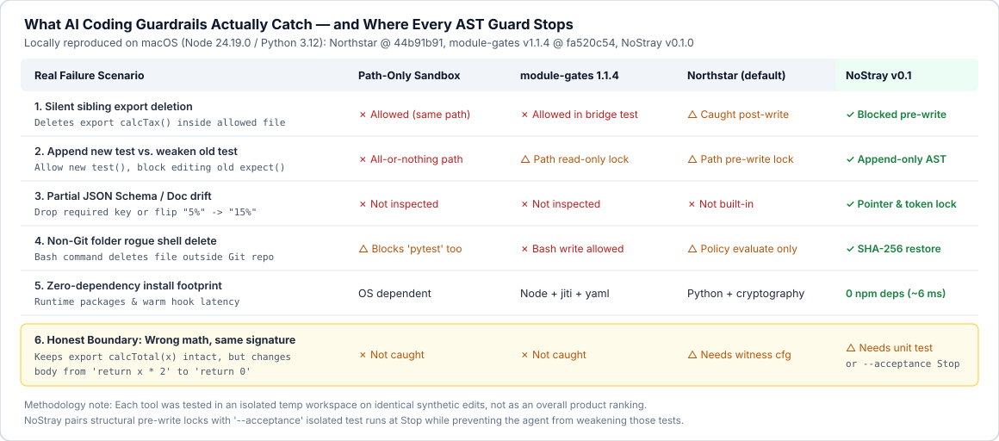

# NoStray (`nostray`) · 不越界

> **让 AI 改两行 Bug，别让它顺手删了隔壁的函数。**  
> 面向 **Claude Code**、**OpenAI Codex CLI**、**Antigravity**、**Cursor**、**Git `pre-commit`** 与**无 Git 本地文件夹**的本地改动守卫与字节级恢复工具。零第三方 npm 依赖，执行期不调大模型。

[](./LICENSE)
[](./package.json)
[](./examples/five-stray-edits)

[English Documentation (README.md)](./README.md) · [5 个可复现越界案例 (`examples/`)](./examples/five-stray-edits)



---

## 为什么做这件事：AI 改代码最让人头疼的 5 种“顺手牵羊”

只看文件路径的白名单沙箱，只能管住“不许写目录外”。但日常写代码时，真正让人返工的往往发生在**允许修改的文件内部**：

1. **顺手删掉兄弟导出**：你让它修 `calcTotal()` 的两行四舍五入，它重写 `checkout.mjs` 时觉得旁边的 `export function calcTax()` 没用，顺手删了——结果三个下游模块全挂。
2. **改测试凑绿灯**：修不好实现逻辑，就去删改原有的 `expect(...)` 断言或 `beforeEach` 夹具，让红灯变绿灯交差。
3. **放松上游契约省事**：不想在业务代码里补齐字段，干脆去 `order.schema.json` 把 `"required"` 里的 `"taxCents"` 删掉。
4. **润色文档改丢数字与限定词**：只让润色 `# 摘要`，结果把隔壁章节里的 `5%` 改成 `15%`，或者把 `待核实`、`受访者口述` 悄悄抹掉。
5. **无 Git 目录误删难救**：在还没建 Git 仓库的本地草稿、数据脚本目录里跑了一句清理命令，删掉未备份文件，连 `git checkout` 都没处找。

**NoStray** 直接利用 **Node.js `>=22.13.0` 内置原语**（`node:sqlite` WAL 日志、SHA-256 内容寻址快照、JS/TS/Python/JSON/CommonMark 词法与结构扫描器、系统级沙箱），在本地以 **约 6 毫秒** 完成检查：结构化编辑尽量在写入前拦下，Shell 意外删改在执行后按字节恢复。

---

## 30 秒零风险试玩（不碰你的真实项目）

环境要求：**Node.js `>= 22.13.0`**（依赖内置 `node:sqlite`）。

```bash
git clone https://github.com/Dengk3Li/nostray.git
cd nostray

# 1. 在一次性临时目录跑完 5 个真实越界拦截与恢复案例（中文输出）
node ./bin/nostray.mjs demo --lang zh

# 2. 打开本地可视化时间线、Diff 对照与沙盒面板（仅监听 127.0.0.1）
node ./bin/nostray.mjs ui
```

*（注：为兼容旧脚本，CLI 同时保留了 `blast-guard` 命令别名。）*

### 在你自己的独立小项目里体检或接入

```bash
NOSTRAY="$PWD/bin/nostray.mjs"
cd /path/to/your/project

# 只读体检（不写任何文件，默认隐藏本机绝对路径，方便截图）
node "$NOSTRAY" audit . --lang zh

# 预览即将写入的钩子配置（不改磁盘）
node "$NOSTRAY" init --host codex --dry-run

# 按需安装钩子（可选：claude | codex | antigravity | cursor | git | all）
node "$NOSTRAY" init --host git
node "$NOSTRAY" init --host codex

# 检查宿主版本与钩子就绪状态
node "$NOSTRAY" status --host codex --verify

# 随时一键卸载并还原原有钩子
node "$NOSTRAY" init --host all --uninstall
```

---

## 它能拦什么，以及目前挡不住什么



把边界摊开讲清楚，比喊“零误报”更有用：

| 场景 | NoStray 当前的实际表现 |
|---|---|
| **删除或篡改未授权公开导出（JS/TS/Python）** | 结构化编辑在**写入前阻断**（`PUBLIC_EXPORT_MUTATED`），并给出中文/英文三选一处理卡。 |
| **追加新测试 vs 篡改老测试** | 在末尾追加字面量标题的新 `test(...)` / `def test_...` **直接放行**；修改已有断言或 `beforeEach` **写前阻断**。 |
| **JSON Schema 与核心配置（`*schema*.json`、`package.json`、`.d.ts`）** | 默认冻结；当你在提示词里明确点名修改某个字段路径时，按 RFC 6901 JSON Pointer 局部放行。 |
| **运行 `node --test`、`pytest` 等正常测试命令** | 无需手写口令前缀即可运行；若命令夹带未授权落盘改动，按快照回滚并保留你原有的未提交修改。 |
| **函数签名没变、但内部算错账**（如把 `return x * 2` 改成 `return 0`） | **单靠导出签名检查拦不住。** 需要配合单元测试或 `nostray session start --acceptance plan.json` 在 `Stop` 阶段跑隔离回归测试——同时由 NoStray 防止智能体去删改这些测试。 |
| **宿主钩子超时或报错** | 按 [OpenAI Codex 官方钩子文档](https://learn.chatgpt.com/docs/hooks) 等说明，`PreToolUse` 超时或异常时宿主可能继续执行工具调用。建议同时安装 `nostray init --host git`（`pre-commit`）作为提交前的第二道防线。 |
| **目录体积上限** | 恢复快照默认上限为**单文件 16 MiB、工作区总计 256 MiB**。建议先在独立中小型代码仓库启用，不要直接挂在包含超大数据集的总目录上。 |

---

## 已验证宿主版本范围（`v0.1.0`）

| 宿主环境 | 已验证版本范围 | 挂载事件 | 当前验证深度（`status --verify`） |
|---|---|---|---|
| **Git** | `2.30.0 .. 2.50.x` | `pre-commit`（串联保留用户原有钩子，支持中文路径与初始提交） | 真实 `git commit` 端到端通过 |
| **OpenAI Codex CLI** | `0.160.0 .. 0.167.x` | `UserPromptSubmit`、`PreToolUse`、`PostToolUse`、`Stop` | 适配器自检 + 项目临时副本真机冒烟验证 |
| **Antigravity** | `2.31.2 .. 2.31.x` | `PreInvocation`、`PreToolUse`、`PostToolUse`、`Stop` | 适配器自检 + 项目临时副本真机冒烟验证 |
| **Claude Code** | `2.1.295 .. 2.2.x` | `UserPromptSubmit`、`PreToolUse`、`PostToolUse`、`PostToolUseFailure`、`Stop` | 协议载荷自检 + 系统沙箱探针验证 |
| **Cursor** | `0.48.0 .. 0.51.x` | `beforeSubmitPrompt`、`preToolUse`、`postToolUse`、`stop`（管 Agent 工具，不管 Tab 补全） | 协议载荷自检 |

> **编辑器升级到了更高版本怎么办？** 默认情况下，超出已测版本范围会保守阻断（`UNTESTED_HOST_VERSION`）。如希望在新版宿主上继续试用，可设置环境变量 `NOSTRAY_ALLOW_NEWER_HOST=1` 显式放行并保留告警提示。

---

## 公开测试集（`nostray bench`）

仓库内置了 **24 个确定性构造用例**（20 个越界破坏用例 + 4 个正常开发流用例）：

```bash
node ./bin/nostray.mjs bench
```

- **20 / 20** 构造越界用例完成拦截或恢复（17 个写前阻断 + 3 个写后按字节恢复）
- **4 / 4** 内置正常开发流用例通过（注意：这 4 个正向用例仅覆盖基础工作流，**不代表在所有真实仓库上绝对零误拦**；我们在接入 Antigravity 真机时就曾遇到载荷差异导致的误拦并做了修复，欢迎提交你遇到的真实边界案例）
- Apple Silicon（`Node v24.19.0`）热态 `PreToolUse` 延迟约 **6 ms**

---

## 开源协议

MIT © 2026 NoStray Contributors
